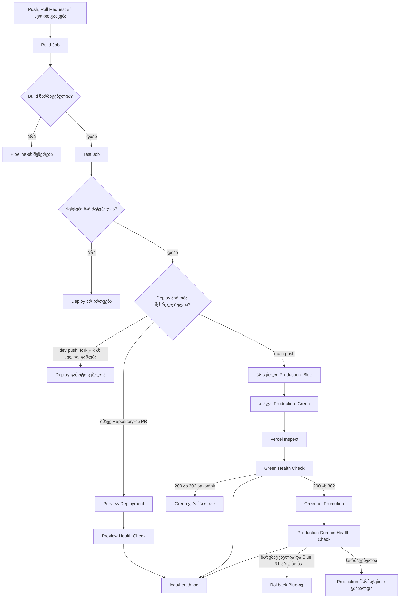

# DevOps Pipeline — რიცხვების სორტირების ვებ-აპლიკაცია

## პროექტის აღწერა

ეს ვებ-აპლიკაცია მომხმარებელს აძლევს მძიმით გამოყოფილი რიცხვების შეყვანის შესაძლებლობას. JavaScript მონაცემებს ამუშავებს და `POST` მოთხოვნას აგზავნის `/api/sort` მისამართზე. Python-ზე შექმნილი Serverless API Merge Sort ალგორითმით ალაგებს რიცხვებს და აბრუნებს თავდაპირველ და დალაგებულ მასივებს.

**გამოყენებული ტექნოლოგიები:** HTML, CSS, JavaScript, Python 3.10, Pytest, GitHub Actions, Vercel და Bash/CURL.

Merge Sort-ის დროითი სირთულეა `O(n log n)`, დამატებითი მეხსიერების სირთულე კი — `O(n)`.

## ფუნქციონალი

- მძიმით გამოყოფილი რიცხვების შეყვანა;
- უარყოფითი და ათწილადი რიცხვების დამუშავება;
- არასწორი მნიშვნელობების გაფილტვრა;
- Merge Sort ალგორითმით ზრდადობით დალაგება;
- `GET /api/sort` და `POST /api/sort` API მოთხოვნები;
- Deployment-ის HTTP სტატუსის შემოწმება — `200` ან `302`.

## პროექტის სტრუქტურა

```text
devops-project/
├── .github/
│   └── workflows/
│       └── ci-cd.yml
├── api/
│   ├── __init__.py
│   └── sort.py
├── images/
│   ├── Vercel Health-Gated Release Flow-2026-11-03-201913.png
│   ├── Screenshot 2026-11-04 033801.png
│   ├── Screenshot 2026-11-03 222941.png
│   ├── Screenshot 2026-11-04 024146.png
│   ├── Screenshot 2026-11-04 024234.png
│   └── unit-tests.png
├── index.html
├── script.js
├── style.css
├── test_app.py
├── healthcheck.sh
├── requirements.txt
├── vercel.json
└── README.md
```

`logs/health.log` იქმნება Workflow-ის მუშაობისას და წყარო კოდში აუცილებელი არ არის.

### ძირითადი ფაილები

- `index.html` — აპლიკაციის მთავარი გვერდი;
- `style.css` — გვერდის სტილები;
- `script.js` — მომხმარებლის მონაცემების დამუშავება და API-ზე გაგზავნა;
- `api/sort.py` — Merge Sort ალგორითმი და API handler;
- `test_app.py` — ავტომატური ტესტები;
- `healthcheck.sh` — Deployment-ის HTTP ხელმისაწვდომობის შემოწმება;
- `.github/workflows/ci-cd.yml` — GitHub Actions Workflow;
- `vercel.json` — Vercel-ის Python API-სა და სტატიკური ფაილების კონფიგურაცია.

## CI/CD Pipeline

Workflow ირთვება შემდეგ შემთხვევებში:

- `push` `main` ან `dev` branch-ზე;
- Pull Request, რომლის სამიზნე branch-ია `main` ან `dev`;
- GitHub Actions-იდან ხელით გაშვებისას (`workflow_dispatch`).

`Build` და `Test` Job-ები ამ მოვლენებზე ეშვება. `Deploy` Job-ის პირობა უფრო შეზღუდულია:

- იმავე Repository-ში შექმნილ Pull Request-ზე იქმნება Preview Deployment;
- `main` branch-ზე `push`-ისას იქმნება Production Deployment;
- `dev` branch-ზე პირდაპირი `push`-ისას `Build` და `Test` სრულდება, მაგრამ `Deploy` არ ეშვება;
- Fork-იდან შექმნილ Pull Request-ზე `Deploy` არ ეშვება;
- ხელით გაშვებისას `Build` და `Test` სრულდება, `Deploy` კი გამოტოვებულია.

### Build Stage

`build` Job მუშაობს `ubuntu-latest` გარემოში და:

1. ჩამოტვირთავს Repository-ის კოდს;
2. აყენებს Python 3.10-ს;
3. აყენებს `requirements.txt`-ში ჩამოთვლილ დამოკიდებულებებს;
4. ამოწმებს Python კოდის სინტაქსს.

კომპილაციის შემოწმების ბრძანებაა:

```bash
python -m compileall -q api
```

### Test Stage

`test` Job იწყება მხოლოდ `build` Job-ის წარმატებით დასრულების შემდეგ (`needs: build`).

ტესტები ეშვება ბრძანებით:

```bash
pytest -v test_app.py
```

ტესტები ამოწმებს:

1. არათანმიმდევრული რიცხვების მასივის დალაგებას;
2. ცარიელ მასივს;
3. უარყოფით რიცხვებს;
4. უკვე დალაგებულ მასივს.

`Deploy` Job-ის წინაპირობაა `Test` Job-ის წარმატებით დასრულება.

### Deploy Stage

`deploy` Job-იც მხოლოდ `test` Job-ის წარმატების შემდეგ იწყება. ის:

1. ჩამოტვირთავს Repository-ის კოდს;
2. აყენებს Vercel CLI-ს;
3. ამოწმებს `VERCEL_TOKEN`-ისა და `VERCEL_SCOPE`-ის არსებობას და Vercel ავტორიზაციას;
4. ამზადებს `logs` დირექტორიას და `healthcheck.sh` სკრიპტს;
5. ქმნის Preview ან Production Deployment-ს, მოვლენის ტიპის მიხედვით.

#### GitHub Actions-ის Deploy პირობა

```yaml
if: >-
  (github.event_name == 'pull_request' &&
   github.event.pull_request.head.repo.full_name == github.repository) ||
  (github.ref == 'refs/heads/main' && github.event_name == 'push')
```

ამ პირობის მიხედვით, `Deploy` Job ეშვება მხოლოდ იმავე Repository-ის Pull Request-ზე ან `main` branch-ზე `push`-ისას. Fork PR-ებზე GitHub Secrets ხელმისაწვდომი არ არის, ამიტომ Deploy გამოტოვებულია.

### Preview Deployment

იმავე Repository-ის Pull Request-ისთვის Vercel ქმნის Preview Deployment-ს:

```bash
vercel deploy --yes \
  --token "$VERCEL_TOKEN" \
  --project "$VERCEL_PROJECT_ID"
```

Workflow ბრძანების შედეგიდან იღებს Deployment URL-ს და `healthcheck.sh`-ით ამოწმებს მის ხელმისაწვდომობას.

## Production Deployment: Blue-Green

`main` branch-ზე `push`-ისას გამოიყენება Blue-Green სტრატეგია.

### 1. არსებული Production Deployment-ის მოძებნა

Workflow Vercel Deployments API-ს სთხოვს ბოლო წარმატებულ Production Deployment-ს. ის წარმოადგენს Blue გარემოს და გამოიყენება საჭიროების შემთხვევაში Rollback-ისთვის.

### 2. Green Deployment-ის შექმნა


Green Deployment Production გარემოსთვის იქმნება შემდეგი ბრძანებით:

```bash
vercel deploy --prod --skip-domain --yes \
  --token "$VERCEL_TOKEN" \
  --project "$VERCEL_PROJECT_ID"
```

--skip-domain ხელს უშლის Vercel-ს, ახალი Deployment ავტომატურად დაუკავშიროს Production Domain-ს.

### 3. Deployment-ის მზადყოფნის შემოწმება

Workflow ელოდება, სანამ Vercel Deployment მზად იქნება:

```bash
vercel inspect "$CANDIDATE_URL" --wait --timeout=5m \
  --token "$VERCEL_TOKEN" \
  --scope "$VERCEL_SCOPE"
```

### 4. Green Deployment-ის Health Check

როცა Deployment მზად იქნება, Workflow ამოწმებს მის URL-ს:

```bash
./healthcheck.sh "$CANDIDATE_URL" logs/health.log
```

Health Check წარმატებულად ითვლება, თუ პასუხის HTTP კოდია `200` ან `302`. თუ Green შემოწმებას ვერ გაივლის, `Deploy` Job შეცდომით სრულდება და Production Domain ძველ Blue Deployment-ზე რჩება.

### 5. Green Deployment-ის Production-ზე გადატანა

წარმატებული Health Check-ის შემდეგ Green Deployment გადადის Production-ზე:

```bash
vercel promote "$CANDIDATE_URL" --yes \
  --token "$VERCEL_TOKEN" \
  --scope "$VERCEL_SCOPE"
```

### 6. Production Domain-ის შემოწმება

Promotion-ის შემდეგ Workflow ამოწმებს საჯარო Production Domain-ს:

```bash
./healthcheck.sh "https://$VERCEL_DOMAIN" logs/health.log
```

`VERCEL_DOMAIN`-ის მნიშვნელობაში მიუთითეთ მხოლოდ დომენის სახელი, `https://`-ის გარეშე.

### 7. Rollback

თუ Production Domain-ის Health Check ვერ გაივლის და Workflow-ს ძველი Deployment-ის URL აქვს, ის ცდილობს Blue Deployment-ზე დაბრუნებას:

```bash
vercel rollback "https://$OLD_DEPLOYMENT_URL" --yes \
  --token "$VERCEL_TOKEN" \
  --scope "$VERCEL_SCOPE"
```

თუ ძველი Deployment-ის URL ვერ მოიძებნა, Rollback ბრძანება არ გაეშვება და Workflow შეცდომით დასრულდება.

## Pipeline-ის დიაგრამა



ასევე გამოყენებულია Workflow-ის სურათიანი დიაგრამა:


## Health Check და ლოგები

`healthcheck.sh` იღებს Deployment URL-ს და ლოგის ფაილის მისამართს:

```bash
mkdir -p logs
./healthcheck.sh "https://example-app.vercel.app" logs/health.log
```

სკრიპტი:
- ასრულებს მაქსიმუმ 10 HTTP მცდელობას;
- ყოველი მცდელობისას იღებს HTTP სტატუსის კოდს;
- 200 ან 302 კოდს წარმატებულ პასუხად მიიჩნევს;
- შედეგებს წერს logs/health.log ფაილში;
- წარმატებისას აბრუნებს exit 0-ს, წარუმატებლობისას კი — exit 1-ს.

ლოგის სტრიქონის ფორმატია:

```text
UTC-თარიღი-და-დრო HTTP-კოდი Deployment-URL
```

მაგალითი:

```text
2026-11-03T23:37:37Z 200 https://example-app.vercel.app
```

GitHub Actions-ის **`health-log`** Artifact შეიცავს `logs/health.log` ფაილს, თუ ის შეიქმნა. Pipeline-ის სრული output ცალკეა ხელმისაწვდომი Actions run-ის Build, Test და Deploy Job-ების ლოგებში.

## GitHub Secrets

GitHub Repository-ში დაამატეთ შემდეგი Secrets:

| Secret | დანიშნულება |
|---|---|
| `VERCEL_TOKEN` | Vercel CLI-ისა და API-ის ავტორიზაცია |
| `VERCEL_ORG_ID` | Vercel Team-ის ID, API მოთხოვნებისთვის |
| `VERCEL_PROJECT_ID` | Vercel Project-ის ID |
| `VERCEL_DOMAIN` | Production Domain, `https://` პრეფიქსის გარეშე |
| `VERCEL_SCOPE` | Vercel Team-ის ან ანგარიშის slug |

Secrets-ის დამატების გზა:

```text
Repository Settings → Secrets and variables → Actions → New repository secret
```

Secret-ის მნიშვნელობები არ დაამატოთ README-ში ან Git Repository-ში.

## Vercel-ის კონფიგურაცია

`vercel.json` კონფიგურაცია:

- `api/sort.py` ფაილს იყენებს Python Serverless Function-ად;
- `index.html`, `style.css` და `script.js` ფაილებს აქვეყნებს როგორც Static Files;
- `/api/sort` მისამართს გადასამისამართებს API Function-ზე;
- CSS, JavaScript და სურათების მოთხოვნებს შესაბამის ფაილებთან აკავშირებს;
- სხვა მისამართებზე აბრუნებს `index.html`-ს.

## ლოკალური გაშვება

საჭიროა Python 3.10, Node.js/npm და Vercel CLI.

დამოკიდებულებების ინსტალაცია:

```bash
python -m pip install -r requirements.txt
```

ტესტების გაშვება:

```bash
pytest -v test_app.py
```

Vercel CLI-ის ინსტალაცია და პროექტის გაშვება:

```bash
npm install -g vercel
vercel link
vercel dev
```

## API

### GET `/api/sort`

პასუხის მაგალითი:

```json
{
  "status": "ok",
  "service": "Python Merge Sort API"
}
```

### POST `/api/sort`

მოთხოვნა:

```json
{
  "array": [42, -5, 10, 0, 7]
}
```

პასუხი:

```json
{
  "original": [42, -5, 10, 0, 7],
  "sorted": [-5, 0, 7, 10, 42]
}
```

## Git Branch სტრატეგია

- `main` — Production ვერსია;
- `dev` — Development და Test ცვლილებები.

## სქრინშოტები და მტკიცებულებები

### წარმატებული GitHub Actions Pipeline


### `dev` Branch-ის Build და Test

ამ გაშვებაში `Build` და `Test` წარმატებით დასრულდა. `Deploy` გამოტოვებულია, რადგან `dev` branch-ზე პირდაპირი `push` Production Deployment-ს არ იწყებს.


### Preview Deployment Vercel-ზე


### წარმატებული Unit Tests


### მომუშავე აპლიკაცია

